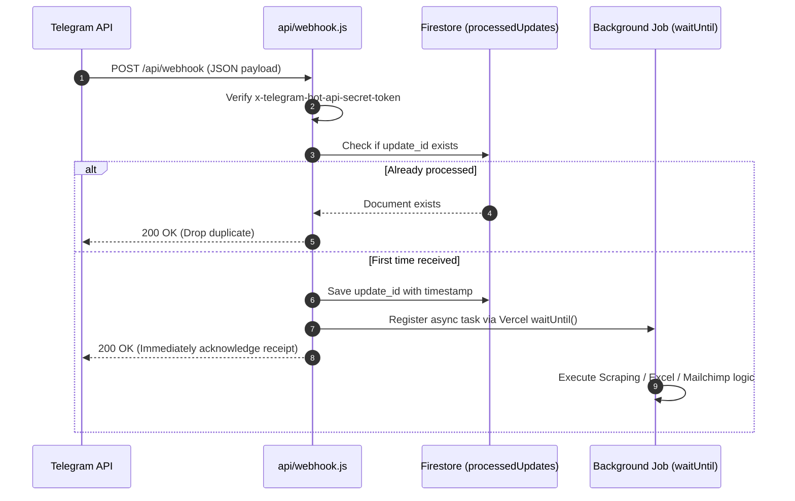
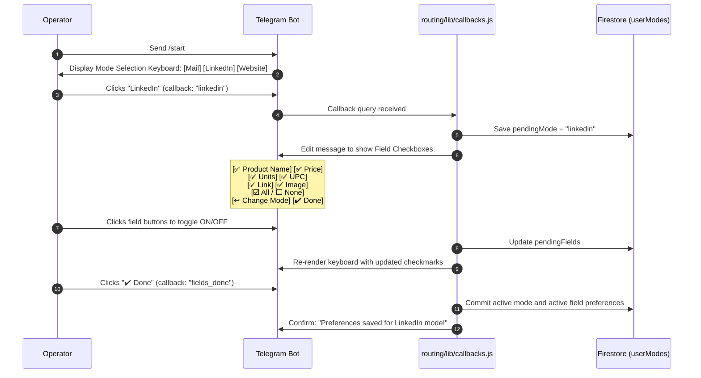
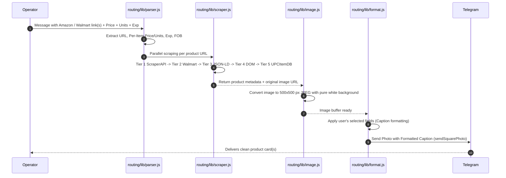
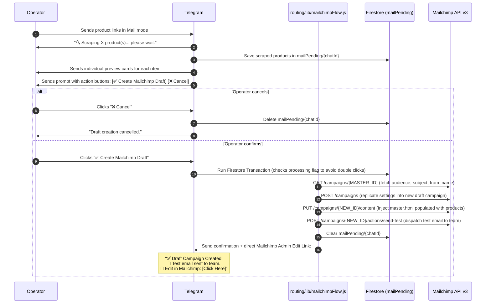
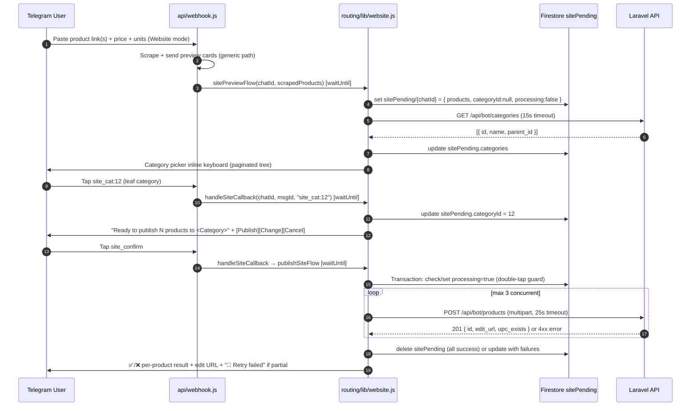
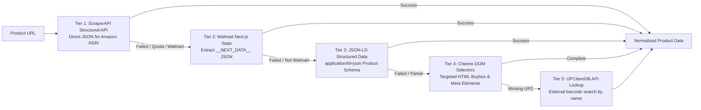

# 📦 Telegram Product & Inventory Bot — Complete Project Overview & Working Flow

> **Version**: 2.0.0  
> **Runtime**: Node.js Serverless (Vercel Functions + `waitUntil` non-blocking async execution)  
> **Platforms & Integrations**: Telegram Bot API, Firebase Firestore, ScraperAPI, UPCItemDB, Mailchimp Marketing API v3, Sharp Image Engine, ExcelJS  
> **Core Purpose**: Automated e-commerce product extraction (Amazon/Walmart), 500×500 image normalization, multi-channel copy generation (Mail, LinkedIn, Website), automated Mailchimp draft campaign generation with team test sends, and wholesale liquidation Excel sheet creation.

---

## 📑 Table of Contents

1. [Executive Overview](#-executive-overview)
2. [End-to-End System Architecture](#-end-to-end-system-architecture)
3. [Complete Project Working Flows](#-complete-project-working-flows)
   - [Flow 1: Inbound Webhook & Deduplication](#flow-1-inbound-webhook--deduplication)
   - [Flow 2: Mode Selection & Field Preferences (`/start`)](#flow-2-mode-selection--field-preferences-start)
   - [Flow 3: Standard Product Scraping & Normalization](#flow-3-standard-product-scraping--normalization)
   - [Flow 4: Automated Mailchimp Campaign Draft Pipeline](#flow-4-automated-mailchimp-campaign-draft-pipeline)
   - [Flow 5: Wholesale Liquidation & Excel Generator](#flow-5-wholesale-liquidation--excel-generator)
   - [Flow 6: Publish to Website](#flow-6-publish-to-website)
4. [Scraping Engine & Fallback Cascade](#-scraping-engine--fallback-cascade)
5. [Image Processing Engine (Sharp)](#-image-processing-engine-sharp)
6. [Database Schema (Firestore)](#-database-schema-firestore)
7. [Repository File Map](#-repository-file-map)
8. [Environment Configuration](#-environment-configuration)
9. [Deployment & Runbook](#-deployment--runbook)

---

## 🚀 Executive Overview

The **Telegram Product & Inventory Bot** transforms unstructured e-commerce product links and liquidation offers received in Telegram into structured, publication-ready assets.

Operators simply paste an Amazon or Walmart link along with operational figures (Price, Quantity/Units, Expiration date, FOB location). The system immediately resolves shortlinks, bypasses anti-bot verification, scrapes deep product metadata (ASIN, UPC, Brand, Name, Image, Pricing), centers product photos onto standard 500×500 white-background canvases, and routes the data to one of three workflows:
1. **Multi-Channel Social/Web Copy**: Formats clean copy tailored for LinkedIn B2B posts or website product catalogs.
2. **Mailchimp Draft Campaigns**: Automatically formats high-conversion email cards, injects them into a responsive HTML master template, creates a draft campaign in Mailchimp, and sends an immediate test email to team inboxes.
3. **Wholesale Deal Workbooks**: Detects bulk liquidation lots, computes unit economics, dynamically estimates missing retail prices, and produces a corporate-styled `.xlsx` workbook.

---

## 🏗️ End-to-End System Architecture

```mermaid
flowchart TD
    TG[Telegram User / Group Message] -->|HTTPS POST| VERCEL[api/webhook.js<br/>Vercel Serverless Function]

    subgraph Security & Deduplication
        VERCEL -->|1. Check Secret Token| SEC{Token Valid?}
        SEC -->|No| R401[401 Unauthorized]
        SEC -->|Yes| DEDUP{update_id in Firestore?}
        DEDUP -->|Yes| R200D[200 OK - Drop Duplicate]
        DEDUP -->|No| STORE_ID[Record update_id in processedUpdates]
    end

    subgraph Router & Message Classifier
        STORE_ID --> ROUTE{Incoming Payload Type}
        ROUTE -->|Callback Query| CB[routing/lib/callbacks.js<br/>Handle Buttons / Toggles / Mailchimp Confirm]
        ROUTE -->|/start command| START[Show Mode Selection Keyboard]
        ROUTE -->|Text Message| CLASSIFY{isInventoryMessage?}
    end

    subgraph Branch 1: Wholesale Excel Generator
        CLASSIFY -->|Yes: Lot Deal Detected| INV[routing/lib/inventory.js<br/>handleInventoryMessage]
        INV --> WAIT1[Vercel waitUntil]
        WAIT1 --> EXCEL[Scrape items + Calculate Unit Economics + Build ExcelJS .xlsx]
        EXCEL --> TG_DOC[Send Telegram Document + Lot Summary]
    end

    subgraph Branch 2: Mail Mode & Mailchimp Pipeline
        CLASSIFY -->|No: Mode = 'mail'| MAIL_PREVIEW[routing/lib/webhook.js<br/>mailPreviewFlow]
        MAIL_PREVIEW --> WAIT2[Vercel waitUntil]
        WAIT2 --> SCRAPE_M[Scrape Products in Parallel + 500x500 Sharp Image]
        SCRAPE_M --> STORE_PENDING[Store scraped data in mailPending/chatId]
        STORE_PENDING --> PREVIEW_TG[Send Preview Cards + 'Create Mailchimp Draft' Button]
        
        CB -->|mc_confirm clicked| MC_EXEC[routing/lib/mailchimpFlow.js<br/>createMailchimpDraftFlow]
        MC_EXEC --> MC_API[Mailchimp API v3:<br/>1. Clone Master Campaign<br/>2. Inject Master HTML Template<br/>3. Dispatch Team Test Email]
        MC_API --> TG_MC_DONE[Send Success Message + Admin Edit URL]
    end

    subgraph Branch 3: Standard Scraping (LinkedIn / Website)
        CLASSIFY -->|No: Mode = 'linkedin' or 'website'| SCRAPE_STD[Scrape Products via routing/lib/scraper.js]
        SCRAPE_STD --> SHARP_STD[500x500 White Canvas Normalization]
        SHARP_STD --> TG_CARDS[Send Formatted Text / Photo Cards to Telegram]
    end
```

---

## 🔄 Complete Project Working Flows

### Flow 1: Inbound Webhook & Deduplication

Telegram retries HTTP webhook requests every ~5 seconds if a 200 OK status code is not received immediately. To avoid duplicate processing and timeouts, the bot follows this protocol:



1. **Secret Token Verification**: Compares the incoming header `x-telegram-bot-api-secret-token` against `TELEGRAM_WEBHOOK_SECRET`.
2. **Chat Allowlist**: If `ALLOWED_CHAT_IDS` is configured, messages from unauthorized chats are ignored.
3. **Atomic Deduplication**: Checks `processedUpdates/{update_id}` in Firestore. If it exists, returns `200 OK` and halts. Otherwise, marks the update as processed.
4. **Non-blocking Execution**: Intensive operations (scraping, image processing, Excel generation, Mailchimp draft creation) are scheduled using `@vercel/functions` `waitUntil()`, returning `200 OK` instantly to prevent Telegram webhook timeout retries.

---

### Flow 2: Mode Selection & Field Preferences (`/start`)

Users can customize output formats and select which fields appear in their generated posts.



---

### Flow 3: Standard Product Scraping & Normalization

When a user posts links in **LinkedIn** or **Website** mode:



**Parsed Metadata Fields**:
- `url`: Product web link (Amazon / Walmart / shortlink)
- `units`: Lot unit quantity (e.g., `2400 Units`)
- `price`: Asking unit price (e.g., `$14.50`)
- `exp`: Expiration date (e.g., `Exp: 08/2026`)
- `fob`: FOB shipping point (e.g., `FOB: Los Angeles, CA`)
- `moq`: Minimum Order Quantity
- `condition`: Condition (e.g., `Brand New`, `Closeout`)

---

### Flow 4: Automated Mailchimp Campaign Draft Pipeline

Mail mode uses a safe 2-step verification protocol to guarantee that marketing emails are never sent without operator review.



**Safety Guarantees**:
- `POST /campaigns/{id}/actions/send` is **never called**. Accidental broadcast to your mailing list is programmatically impossible.
- Merged product strings are sanitized and Mailchimp merge tags (`*|TAG|*`) are escaped to prevent template injection vulnerabilities.
- Firestore transactional locking prevents duplicate campaigns if an operator clicks the button twice in rapid succession.

---

### Flow 5: Wholesale Liquidation & Excel Generator

When messages represent bulk wholesale lots (e.g., multiple items with a stated total retail valuation and an asking price), the bot automatically switches into wholesale deal mode.

```mermaid
flowchart TD
    MSG[Incoming Message] --> CHECK{isInventoryMessage?<br/>'Retail value $X' AND 'Asking price $Y'<br/>OR 2+ URLs AND 'Asking Price - $X'}
    CHECK -->|Yes| PARSE[Parse Lot Economics & Individual Items]
    CHECK -->|No| STD[Standard Product Scraper Flow]

    PARSE --> SCRAPE[Parallel Scrape Products: Name, ASIN, UPC, Live Retail Price]
    SCRAPE --> CALC{Missing Retail Prices?}
    CALC -->|Yes| ESTIMATE[Intelligently Allocate Estimated Retail Values based on Stated Lot Total]
    CALC -->|No| WORKBOOK[Generate ExcelJS Workbook]
    ESTIMATE --> WORKBOOK

    subgraph ExcelJS Styling
        WORKBOOK --> H[Row 2 Header: Navy Blue #1F497D with Bold White Text]
        WORKBOOK --> D[Data Rows: Soft Blue #DCE6F1 Zebra Striping]
        WORKBOOK --> F[Formatting: $#,##0.00 currency, clickable hyperlinks]
        WORKBOOK --> T[Summary Totals Row: Gold #FFE599 with Unit Totals & Margin %]
    end

    T --> SEND_DOC[Send .xlsx Document to Telegram]
    T --> SEND_TEXT[Send Accompanying Lot Economics Summary Message]
```



**Generated Excel Columns**:
1. `Product Name`: Scraped clean product title
2. `Retail Price`: Unit retail price (scraped or dynamically estimated)
3. `Unit`: Quantity available
4. `UPC Code`: Extracted barcode
5. `ASIN Code`: Amazon 10-character identifier
6. `Product Link`: Live clickable URL
7. `Total Price`: Calculated product total (`Retail Price * Units`)

---

### Flow 6: Publish to Website

Triggered automatically after the scrape+preview cards are sent in **Website mode** (when `SITE_URL` and `SITE_API_SECRET` are configured).



**Field Mapping Summary**:

| Laravel Field | Source | Notes |
|---|---|---|
| `name` | `product.name` | Required |
| `price_unit` | `product.price` | `"$3.50"` → `3.5` |
| `quntity` | `product.units` | `"2,400"` → `2400` |
| `retail_price` | `product.scrapedPrice` | Float; omit if null |
| `minimum_quntity` | `product.moq` | Omit if null |
| `brand` | `product.brand` | Omit if empty |
| `location` | `product.fob` | Omit if null |
| `asin_no` | `product.asin` | Omit if empty |
| `upc` | `product.upc` | Omit if empty |
| `expiration_date` | `product.exp` | MM/YYYY → last day; omit if unparseable |
| `amz_link`/`walmart_link` | `product.url` | Decided by URL hostname |
| `image` | `product._sq` Buffer | JPEG multipart; omit if null |
| `condition` | `"New"` | Constant |
| `lead_time` | `"3-4 Days"` | Constant |
| `packaging` | `"Retail Packaging"` | Constant |
| `status` | `"inactive"` | Constant — always creates a draft |
| `auto_delete` | `"false"` | Constant |

---

## 🔍 Scraping Engine & Fallback Cascade

Implemented in [routing/lib/scraper.js](file:///c:/Users/Admin/Desktop/Ajay/closeoutcenter/Code/Telegram-bot-vercel/routing/lib/scraper.js), the scraper employs a 5-tier fallback cascade with proxy rotation:



### Key Scraper Capabilities:
- **Amazon CDN URL Cleaning**: Uses regular expressions to strip dynamic resizing tokens (e.g., `._AC_SX679_`) from Amazon image URLs, retrieving full-resolution source photography.
- **Shortlink Resolution**: Follows redirects on `a.co` and `amzn.to` links while auto-correcting OCR/transcription typos (e.g., `a.co/d/d` → `a.co/d/0`).
- **Quota Limit Handling**: If ScraperAPI returns a 403 or quota exceeded status, it transparently degrades to direct ASIN extraction and standard DOM scraping.

---

## 🖼️ Image Processing Engine (Sharp)

Implemented in [routing/lib/image.js](file:///c:/Users/Admin/Desktop/Ajay/closeoutcenter/Code/Telegram-bot-vercel/routing/lib/image.js):

- **500×500 Square Canvas**: Standardizes product photos from Amazon and Walmart into high-resolution uniform squares.
- **Pure White Background (`#FFFFFF`)**: Automatically converts transparent WebP and PNG backgrounds to crisp white.
- **Aspect Ratio Integrity**: Uses `fit: "inside"` and `composite({ gravity: "center" })` so images are never distorted, squashed, or cut off.
- **Native Scale Protection**: Images smaller than 500px are centered without upscaling, preventing blurriness and pixelation.
- **Parallel Pre-computation**: Images are processed concurrently in memory as buffers (`product._sq`) before messages are dispatched to Telegram.

---

## 🗄️ Database Schema (Firestore)

| Collection | Document ID | Key Fields | Description |
|:---|:---|:---|:---|
| `processedUpdates` | `String(update_id)` | `ts: Number` | Webhook deduplication record. Ensures Telegram's 5s retry loop never double-processes an event. |
| `userModes` | `String(chat_id)` | `mode: String`<br/>`fields: Object`<br/>`pendingMode: String`<br/>`pendingFields: Object` | Persists operator preferences for active mode (mail, linkedin, website) and enabled fields. |
| `mailPending` | `String(chat_id)` | `products: Array`<br/>`fields: Array`<br/>`processing: Boolean`<br/>`processingAt: Number`<br/>`createdAt: Number` | Staged product dataset waiting for Mailchimp confirmation. Locked with Firestore transactions. |
| `sitePending` | `String(chat_id)` | `products: Array`<br/>`categoryId: Number\|null`<br/>`categories: Array`<br/>`processing: Boolean`<br/>`processingAt: Number`<br/>`createdAt: Number` | Staged product dataset waiting for Website publish confirmation. Same transaction-lock pattern as `mailPending`. |

---

## 📁 Repository File Map

```
Telegram-bot-vercel/
├── api/
│   └── webhook.js             # Vercel entrypoint: Webhook validation, deduplication, router
├── routing/
│   ├── lib/
│   │   ├── callbacks.js       # Inline keyboard callback router (mode, fields, mailchimp, website)
│   │   ├── env.js             # Local environment variable loader fallback
│   │   ├── firebase.js        # Firebase Admin SDK & Firestore database client
│   │   ├── format.js          # Channel-specific message formatting (Mail, LinkedIn, Website)
│   │   ├── image.js           # Sharp 500x500 white-canvas normalization engine
│   │   ├── inventory.js       # Wholesale lot detection & ExcelJS workbook generator
│   │   ├── mailchimp.js       # Mailchimp API v3 client (replicate, create draft, send test)
│   │   ├── mailchimpFlow.js   # 2-step preview and draft generation orchestrator
│   │   ├── mailchimpTemplate.js# Product card HTML generator & master template injector
│   │   ├── parser.js          # Extraction of URLs, prices, quantities, dates from text
│   │   ├── scraper.js         # 5-tier multi-source e-commerce scraping engine
│   │   ├── telegram.js        # Telegram Bot API wrapper (messages, photos, documents)
│   │   └── website.js         # Publish-to-Website flow (Flow 6) — categories + publish
│   └── templates/
│       ├── master.html        # Responsive Master HTML Email Template for Mailchimp
│       ├── master.css         # Master email stylesheet
│       └── master.js          # Template asset helper
│       ├── master.html        # Responsive Master HTML Email Template for Mailchimp
│       ├── master.css         # Master email stylesheet
│       └── master.js          # Template asset helper
├── public/
│   └── index.html             # Operational status health check page
├── mailchimp_integration_plan.md # Architectural plan for Mailchimp integration
├── BUG_FIX_PLAN.md            # Maintenance and bug fix tracking documentation
├── package.json               # Dependencies & scripts
├── vercel.json                # Vercel deployment configuration (300s function duration)
├── README.md                  # Quickstart & operational runbook
└── PROJECT_OVERVIEW.md        # This technical blueprint & system overview
```

---

## 🔑 Environment Configuration

| Variable | Required | Description |
|:---|:---:|:---|
| `BOT_TOKEN` | **Yes** | Telegram Bot API token from `@BotFather`. |
| `FIREBASE_PROJECT_ID` | **Yes** | Google Cloud / Firebase project identifier. |
| `FIREBASE_CLIENT_EMAIL` | **Yes** | Firebase service account client email address. |
| `FIREBASE_PRIVATE_KEY` | **Yes** | Firebase service account private key (with `\n` line breaks). |
| `SCRAPER_API_KEY` | **Yes** | ScraperAPI key for proxy rotation and structured product data. |
| `MAILCHIMP_API_KEY` | Optional | Mailchimp API v3 key (e.g. `md5hash-us11`). Required for Mail mode. |
| `MAILCHIMP_MASTER_CAMPAIGN_ID` | Optional | ID of the campaign to clone for audience and tracking settings. |
| `MAILCHIMP_TEST_EMAILS` | Optional | Comma-separated email addresses to receive draft test broadcasts. |
| `ALLOWED_CHAT_IDS` | Optional | Comma-separated Telegram Chat IDs for access restriction. |
| `TELEGRAM_WEBHOOK_SECRET` | Optional | Shared secret token passed in `x-telegram-bot-api-secret-token`. |
| `SITE_URL` | Optional | Laravel site base URL. Required to enable Publish to Website. |
| `SITE_API_SECRET` | Optional | `x-api-key` header for the Laravel Bot API. Required with `SITE_URL`. |

---

## 🚀 Deployment & Runbook

### 1. Deploy to Vercel
```bash
vercel --prod
```

### 2. Set Up Telegram Webhook
Register your Vercel deployment URL with Telegram:
```bash
curl -F "url=https://your-app.vercel.app/api/webhook" \
     -F "secret_token=YOUR_TELEGRAM_WEBHOOK_SECRET" \
     https://api.telegram.org/bot<YOUR_BOT_TOKEN>/setWebhook
```

### 3. Verify Health Check
Open `https://your-app.vercel.app` in your browser. The page should display:
```
Telegram Bot Webhook is Active
```
Send `/start` to your bot in Telegram to select your mode and begin processing deals!
